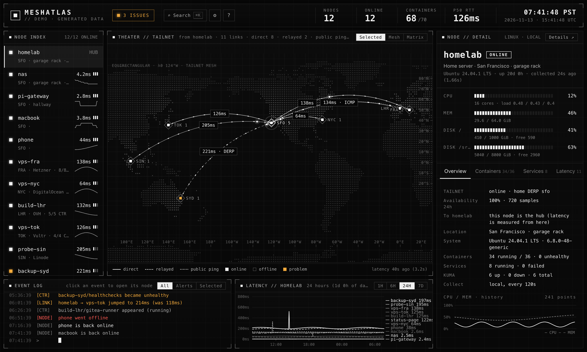
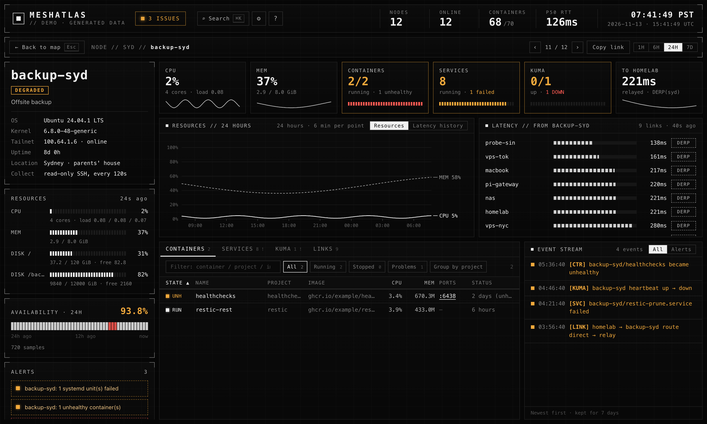
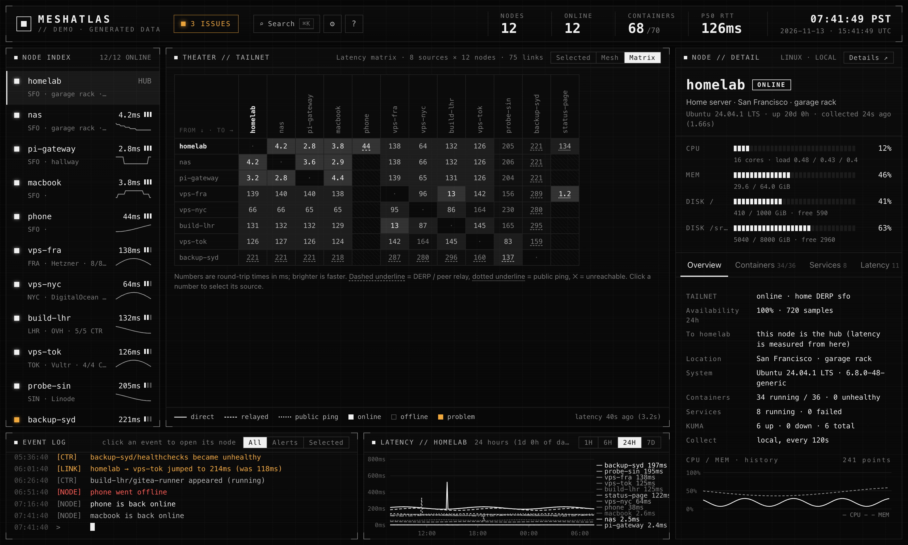
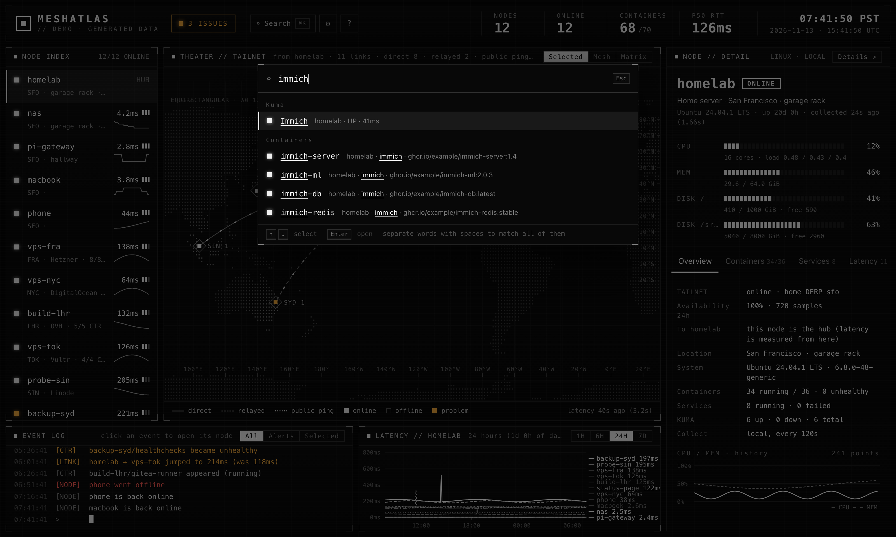

<div align="center">

# MeshAtlas

**A live, HUD-style map of your Tailscale tailnet.**
Where every node is, how it is connected — direct, DERP or peer relay — and what is running on it.

[**Live demo**](https://lij768423-svg.github.io/meshatlas/) · [Quick start](#quick-start) · [Configuration](#configuration) · [中文说明](README.zh-CN.md)



</div>

---

The Tailscale admin console tells you which machines exist. MeshAtlas shows you **the network between them**:
a world map with every node placed by its nearest DERP region, links drawn as direct or relayed paths with real
round-trip times, a full latency matrix, and — if you give it read-only SSH — the containers, systemd units, CPU,
memory and disks of each host. It is one Python process with **zero dependencies**, and nothing ever leaves your tailnet.

## Highlights

- **Zero config.** Run it on any machine in your tailnet. Nodes come from `tailscale status`, locations from the DERP
  map, latency from `tailscale ping`. Add a config file only when you want more.
- **Paths, not just pings.** Every link shows whether WireGuard went direct, through a DERP region or through a
  peer relay, and the event log tells you when that changes.
- **Full mesh.** Nodes you can SSH into ping all the others, giving a complete N×N latency matrix.
- **What runs where.** Read-only collection over SSH: `docker ps`/`docker stats`, `systemctl list-units`, `/proc`.
  No agent to install, no secrets read (no `docker inspect`, no environment variables).
- **Detail pages** for every node: CPU / memory history, availability, per-link stats (P95, jitter), a sortable
  container table, services, Uptime Kuma monitors and an event stream.
- **Built for daily use.** ⌘K search across nodes, containers and services, an issues list, browser notifications,
  deep links, keyboard shortcuts, English and 中文, works on a phone.
- **Not only the tailnet.** Watch public servers with ICMP ping from the hub or from any SSH node.
- **Small and boring to run.** Python 3.9+, standard library only on 3.11+, SQLite history (7 days), no build step, no Node,
  no database server. Typically 30–60 MB of RAM.

| | | |
|---|---|---|
|  |  |  |

## Quick start

**Just looking?** Open the [**live demo**](https://lij768423-svg.github.io/meshatlas/). It runs in your browser
with generated data; nothing to install.

> MeshAtlas is **not on PyPI yet**, so `pip install meshatlas` and `uvx meshatlas` do not work. Until the first
> release, run it from the repository:

**From a checkout** — no install, no dependencies (Python 3.11+; on 3.9/3.10 also `pip install tomli` if you
use a `.toml` config):

```bash
git clone https://github.com/lij768423-svg/meshatlas && cd meshatlas
PYTHONPATH=src python3 -m meshatlas demo   # generated data, no tailnet needed; open http://127.0.0.1:8765
PYTHONPATH=src python3 -m meshatlas        # the real thing, on any machine in your tailnet
```

**Or install straight from GitHub** with [uv](https://docs.astral.sh/uv/) or pipx:

```bash
uvx --from git+https://github.com/lij768423-svg/meshatlas meshatlas demo
pipx install git+https://github.com/lij768423-svg/meshatlas && meshatlas
```

MeshAtlas listens on this machine's Tailscale IP (port 8765), so the page is reachable from every device in the
tailnet and from nowhere else. If something looks off, run the `check` command
(`meshatlas check`, or `PYTHONPATH=src python3 -m meshatlas check` in a checkout).

### Docker

There is no published image yet; build one from the checkout (Linux host):

```bash
docker build -t meshatlas .
docker run -d --name meshatlas --network host --restart unless-stopped \
  -v /var/run/tailscale/tailscaled.sock:/var/run/tailscale/tailscaled.sock \
  -v meshatlas-data:/data \
  meshatlas run --host auto
```

or `docker compose up -d --build` with [`docker-compose.yml`](docker-compose.yml). The container uses the host's
`tailscaled` through its socket; it does not join the tailnet itself.

### systemd

`pipx install git+https://github.com/lij768423-svg/meshatlas`, then copy [`examples/meshatlas.service`](examples/meshatlas.service) to
`~/.config/systemd/user/` and `systemctl --user enable --now meshatlas`.

## Configuration

Everything is optional. `meshatlas init` writes a commented `meshatlas.toml` that lists the nodes it found.
MeshAtlas looks for `./meshatlas.toml`, `~/.config/meshatlas/meshatlas.toml` and `/etc/meshatlas/meshatlas.toml`
(or `-c path`). JSON works too.

```toml
[locations.home]                 # your own places
name = "Home"
lat = 37.77
lon = -122.42

[nodes.nas]                      # key = MagicDNS name of the node
location = "home"                # a [locations] key or a DERP code such as "fra"
role = "NAS"
ssh = "admin@nas"                # turn on read-only collection over SSH
notes = ["Scrub runs on the 1st"]

[[external]]                     # a server outside the tailnet, watched with ICMP
id = "status-page"
address = "203.0.113.10"
location = "fra"
probe_from = ["hub", "nas"]

[kuma]                           # optional: an Uptime Kuma public status page
url = "http://100.64.0.1:3001"
slug = "default"
```

See [`examples/meshatlas.example.toml`](examples/meshatlas.example.toml) for every option. Display preferences
(hidden nodes, sort order, map labels, top-bar metrics, language…) are set in the page itself and stored per browser.

## Proxy view (optional)

If you run [Mihomo](https://github.com/MetaCubeX/mihomo) (Clash Meta) or a Clash-based client, MeshAtlas can draw its
routes in a **Proxy** map mode: for each entry you pick (a group or a proxy), the group's options as chains of hops —
device → relay → exit → where the traffic lands — with the latency of each hop and the option that is probably in use.

1. Make a snapshot of each config. It is a whitelist: proxy names, protocols, servers, ports, `dialer-proxy`, the
   transport (`network`, such as `ws`) and the provider a proxy came from; group names, types, members and `use`; and
   each provider's name, type and proxy count. Passwords, UUIDs, keys, SNI, paths and subscription URLs are never
   written. Proxies of `proxy-providers` come from the provider's local cache file; nothing is downloaded. Run it where
   the Mihomo config is and copy the JSON over if MeshAtlas runs on another machine.

   ```bash
   meshatlas proxy-snapshot ~/.config/mihomo/config.yaml -o ~/.config/meshatlas/proxy/laptop.json
   ```

   Only this command needs PyYAML, and it has to be in MeshAtlas's own environment:

   - from a checkout: `python3 -m pip install pyyaml` (the same `python3` you run it with), then
     `PYTHONPATH=src python3 -m meshatlas proxy-snapshot …`
   - pipx: `pipx inject meshatlas pyyaml`
   - uvx: `uvx --from git+https://github.com/lij768423-svg/meshatlas --with pyyaml meshatlas proxy-snapshot …`

   A snapshot holds no secrets but does list your real servers, so keep it out of git: `~/.config/meshatlas/proxy/`
   is outside any checkout, and this repository's `.gitignore` also skips `/proxy/` and `*.snapshot.json`. Snapshots
   are read when MeshAtlas starts: after making a new one, restart it (`systemctl --user restart meshatlas`, say).

2. Point the config at it:

   ```toml
   [[proxy.sources]]
   id = "laptop"
   label = "Laptop · Clash"
   origin = "my-laptop"                   # the node its traffic starts from, or "hub"
   files = ["~/.config/meshatlas/proxy/laptop.json"]   # relative paths start at the config file's directory
   entries = [["Everything else", "PROXY"], ["AI", "AI"]]   # [label, group or proxy name]

   [proxy.endpoints."203.0.113.10"]       # optional: what a server is
   label = "Frankfurt relay"
   loc = "fra"                            # a [locations] key or a DERP code
   node = "vps-fra"                       # this server is that node: hops leaving it are measured there
   role = "relay"                         # relay | residential | provider | stale
   ```

**What is measured, and from where.** A hop is timed on the machine it leaves, if MeshAtlas can run commands there.
The first hop leaves the origin: it is measured there when the origin is the hub or has `ssh`, otherwise (a laptop,
say) from the hub and drawn as a reference. A hop that leaves a proxy server is measured only when that server is one
of your nodes (its endpoint sets `node`, or its address is a node's name, Tailscale IP or `[[external]]` address) and
that node is the hub or has `ssh`. Hops leaving a provider's or anyone else's server are drawn as *not measured*; a
route with such a hop has no total, so `url-test` leaves it out of the latency comparison. TCP protocols get a TCP
connect time (three tries, median and loss); Hysteria, Hysteria2, TUIC and WireGuard get an ICMP ping. MeshAtlas opens
a connection and closes it: it never speaks a proxy protocol and never reads Mihomo's config or API while running. A
round runs every `interval` seconds (300 by default).

**Which option is in use** is inferred with Mihomo's rules: `select` → the first member, `fallback` / `load-balance`
→ the first working one, `url-test` → the fastest, so a manual choice in a `select` group may differ. A `select`
group keeps its members in order: a member with no route (REJECT, an empty group, a name missing from the snapshot)
stays in its place as a dead option, so a `select` group that starts with REJECT is shown as rejecting. `DIRECT` is
a real option with no hops; proxies of type `direct` count as DIRECT, and `reject` / `dns` as REJECT. Only the first
four members of a group (all members of a `relay` group) are drawn, measured and considered, and the page says how
many more there are: for a `url-test` group fed by a 40-node subscription, "in use" is the fastest of the first four.

**Before you turn it on:**

- **DNS.** Proxy server hostnames are resolved every round by the system resolver of each measuring machine (the
  hub and the SSH nodes that measure), so they reach whatever DNS server those machines use. With
  `resolve_hostnames = false` under `[proxy]`, MeshAtlas resolves nothing: hops to a hostname are not measured
  ("hostname (resolve_hostnames = false)"), hops to an IP address still are.
- **TUN and fake-IP.** A measuring machine must not run a proxy in TUN or transparent mode itself (Mihomo, Clash,
  sing-box…), unless the proxy servers are excluded from it. Otherwise the local TUN answers the connection: every
  hop looks reachable in about 0 ms, dead ones too, and the probe is routed by that proxy's rules. When a hostname
  resolves into the fake-IP range 198.18.0.0/15, MeshAtlas shows the hop as *intercepted* ("intercepted by a local
  TUN/fake-IP proxy on …") instead of a number. A TUN that captures connections to plain IP addresses cannot be
  detected that way; sub-millisecond times to another country are the sign.

[`examples/meshatlas.example.toml`](examples/meshatlas.example.toml) also covers `resolve_hostnames`, `next` (a hop a
server forwards to by itself; `proto` is `tcp`, `udp` or a Mihomo proxy type), `[proxy.locations]` and
`[[proxy.regions]]`.

## How it works

| What | Where it comes from |
|---|---|
| Nodes, online state, OS, tags | `tailscale status --json` on the machine running MeshAtlas (the *hub*) |
| Location | your config, else the node's home DERP region (`tailscale debug derp-map`); a hub on a custom DERP region uses the nearest official one from `tailscale netcheck` |
| Latency and path | `tailscale ping` from the hub to every online peer; with `mesh = true`, also from every SSH node |
| Containers, units, CPU, memory, disks | a read-only Python script piped to `python3 -` over SSH (nothing is written to the remote disk) |
| Public servers | `ping` from the hub or an SSH node |
| Proxy hops (optional) | a probe script piped to `python3 -` on the hub or over SSH: a TCP connect to each proxy server, or `ping` for UDP protocols |
| History | SQLite in `~/.local/state/meshatlas` (or `MESHATLAS_DATA`), kept for 7 days |

The exact remote commands are in [`remote_collect.py`](src/meshatlas/remote_collect.py),
[`tailscale.py`](src/meshatlas/tailscale.py) and, for the proxy view, `PROBE_SCRIPT` in
[`proxy.py`](src/meshatlas/proxy.py). See [SECURITY.md](SECURITY.md) for the security model.

## Security in one paragraph

MeshAtlas only reads. It binds to the Tailscale IP by default, so tailnet ACLs decide who can open it; add
`token = "..."` (or `MESHATLAS_TOKEN`) for a shared secret, or put it behind `tailscale serve` for HTTPS. SSH runs
with `BatchMode=yes` using your existing keys and `~/.ssh/config`. The browser never receives SSH targets, and the
remote collector never reads environment variables or container configs. With the proxy view on, the page also gets
your proxy servers' addresses and ports.

## FAQ

**My nodes are in the wrong city.** Locations default to each node's *nearest DERP region*, which is a guess.
Set `location` for the node (a DERP code such as `"fra"` or your own `[locations.x]`).

**Does it work with Headscale?** It uses only the `tailscale` CLI on the hub, so it should; DERP coordinates come
from whatever DERP map your control server hands out. Reports welcome.

**Why not an agent?** SSH is already there, already secured, and already audited. MeshAtlas runs a short read-only
script and leaves nothing behind.

## Development

```bash
git clone https://github.com/lij768423-svg/meshatlas && cd meshatlas
python -m pip install -e '.[dev]'
pytest && ruff check src tests
meshatlas demo        # UI with generated data; edit files in src/meshatlas/web and reload
```

The front end is plain JavaScript (D3 for the map) with no build step. See [CONTRIBUTING.md](CONTRIBUTING.md).

## Friendly links

- [LINUX DO — 新的理想型社区](https://linux.do)

## License

MIT. Bundled D3, topojson-client and world-atlas data are ISC licensed — see [NOTICE.md](NOTICE.md).
MeshAtlas is not affiliated with Tailscale Inc.
