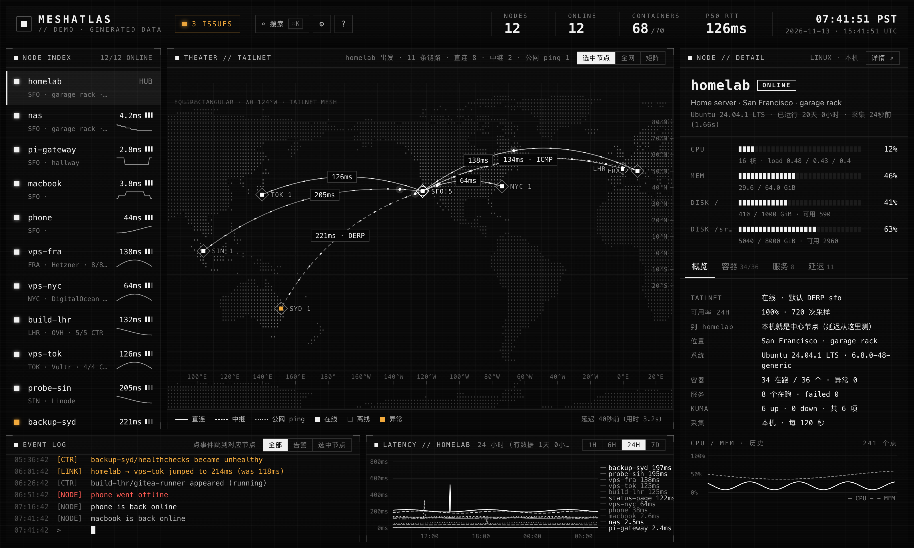
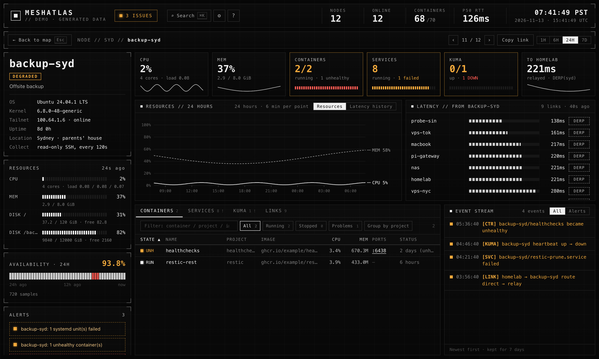
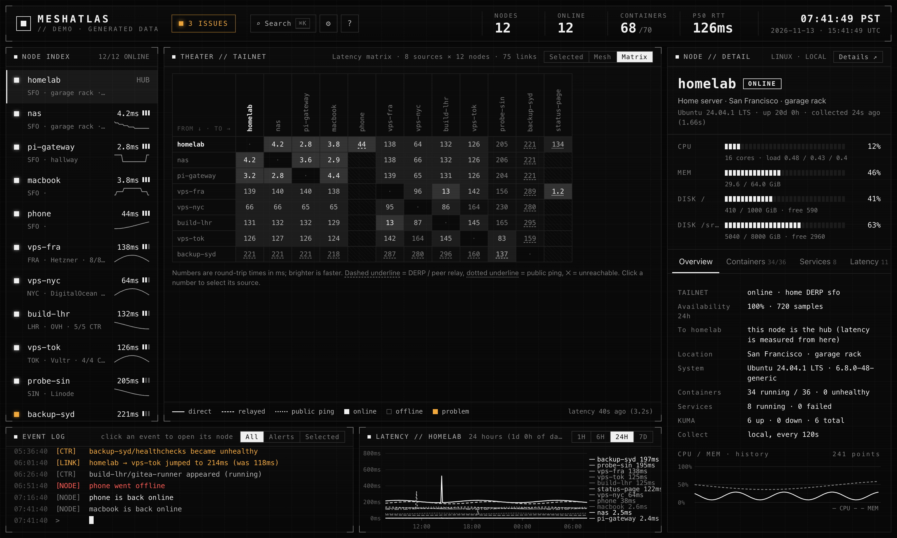
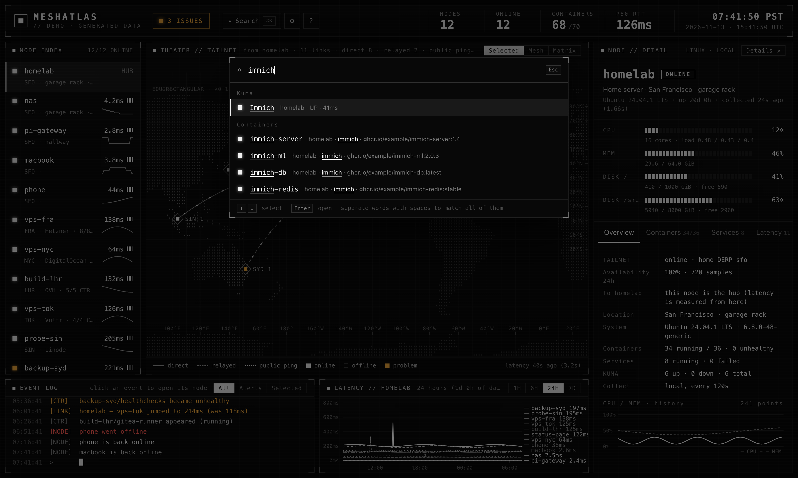

<div align="center">

# MeshAtlas

**你的 Tailscale tailnet 实时地图。**
每台机器在哪、走直连还是 DERP 或 peer relay、上面跑着什么，一屏看完。

[**在线演示**](https://lij768423-svg.github.io/meshatlas/) · [快速开始](#快速开始) · [配置](#配置) · [English](README.md)



</div>

---

Tailscale 管理后台能告诉你有哪些机器。MeshAtlas 让你看到**机器之间的网络**：按最近的 DERP 区域把节点摆在世界地图上，
每条连线标出是直连还是中继、实测往返延迟是多少，还有完整的延迟矩阵；给它只读 SSH 的话，还能看到每台机器的容器、
systemd 服务、CPU、内存和磁盘。它只是一个 Python 进程，**没有任何依赖**，数据不出你的 tailnet。

## 亮点

- **零配置。** 在 tailnet 里任意一台机器上运行即可：节点来自 `tailscale status`，位置来自 DERP 地图，延迟来自
  `tailscale ping`。需要更多功能时再写配置文件。
- **看路径，不只是 ping。** 每条连线都标出 WireGuard 走的是直连、哪个 DERP 区域还是 peer relay，路径变了事件日志会记下来。
- **全网矩阵。** 能 SSH 的节点也会去 ping 其他所有节点，得到完整的 N×N 延迟矩阵。
- **哪台机器上跑着什么。** 通过 SSH 只读采集 `docker ps` / `docker stats`、`systemctl list-units`、`/proc`。
  不用装 agent，也不读敏感信息（不跑 `docker inspect`，不读环境变量）。
- **每台机器都有详情页：** CPU / 内存历史、可用率、每条链路的统计（P95、抖动）、可排序的容器表、服务、
  Uptime Kuma 监控和事件流。
- **日常好用。** ⌘K 搜索节点、容器和服务，异常列表，浏览器通知，可分享的链接，快捷键，中英双语，手机上也能看。
- **不止 tailnet。** 可以从中心节点或任意 SSH 节点用 ICMP 监控公网服务器。
- **轻量省心。** Python 3.9+，3.11 起只用标准库，历史存在 SQLite（7 天），不用构建，不用 Node，不用数据库服务。

| | | |
|---|---|---|
|  |  |  |

## 快速开始

**只想看看效果？** 直接打开[**在线演示**](https://lij768423-svg.github.io/meshatlas/)：数据在浏览器里现场生成，什么都不用装。

> MeshAtlas **还没有发布到 PyPI**，所以 `pip install meshatlas`、`uvx meshatlas` 现在都装不上。
> 正式发布之前，请从仓库运行：

**从源码直接跑**：不用安装，没有依赖（Python 3.11+；3.9/3.10 如果要用 `.toml` 配置，先 `pip install tomli`）：

```bash
git clone https://github.com/lij768423-svg/meshatlas && cd meshatlas
PYTHONPATH=src python3 -m meshatlas demo   # 生成的数据，不需要 tailnet；打开 http://127.0.0.1:8765
PYTHONPATH=src python3 -m meshatlas        # 正式运行：在 tailnet 里的任意一台机器上
```

**或者用 [uv](https://docs.astral.sh/uv/) / pipx 直接从 GitHub 安装：**

```bash
uvx --from git+https://github.com/lij768423-svg/meshatlas meshatlas demo
pipx install git+https://github.com/lij768423-svg/meshatlas && meshatlas
```

MeshAtlas 默认监听本机的 Tailscale IP（端口 8765），所以 tailnet 里的设备都能打开，外网打不开。
有问题先跑 `check` 自检（装好的用 `meshatlas check`，源码目录里用 `PYTHONPATH=src python3 -m meshatlas check`）。

### Docker

还没有发布镜像，先在源码目录里自己构建（Linux 宿主机）：

```bash
docker build -t meshatlas .
docker run -d --name meshatlas --network host --restart unless-stopped \
  -v /var/run/tailscale/tailscaled.sock:/var/run/tailscale/tailscaled.sock \
  -v meshatlas-data:/data \
  meshatlas run --host auto
```

也可以用 [`docker-compose.yml`](docker-compose.yml)：`docker compose up -d --build`。容器通过 socket 使用宿主机的 `tailscaled`，自己不用登录 Tailscale。

### systemd

`pipx install git+https://github.com/lij768423-svg/meshatlas`，再把 [`examples/meshatlas.service`](examples/meshatlas.service) 复制到
`~/.config/systemd/user/`，然后 `systemctl --user enable --now meshatlas`。

## 配置

所有配置项都是可选的。`meshatlas init` 会根据你的 tailnet 生成一份带注释的 `meshatlas.toml`。
程序会依次查找 `./meshatlas.toml`、`~/.config/meshatlas/meshatlas.toml`、`/etc/meshatlas/meshatlas.toml`（也可以 `-c 路径`）。
也支持 JSON。

```toml
[locations.home]                 # 你自己的地点
name = "家"
lat = 30.25
lon = 120.2

[nodes.nas]                      # 键是节点的 MagicDNS 名字
location = "home"                # [locations] 里的键，或者 DERP 区域代码，比如 "tok"
role = "NAS"
ssh = "admin@nas"                # 开启 SSH 只读采集
notes = ["每月 1 号跑 scrub"]

[[external]]                     # 不在 tailnet 里的服务器，用 ICMP 监控
id = "status-page"
address = "203.0.113.10"
location = "fra"
probe_from = ["hub", "nas"]

[kuma]                           # 可选：Uptime Kuma 公开状态页
url = "http://100.64.0.1:3001"
slug = "default"
```

全部选项见 [`examples/meshatlas.example.toml`](examples/meshatlas.example.toml)。显示偏好（隐藏节点、排序、地图标签、
顶栏指标、语言等）在页面的设置里改，存在各自的浏览器里。

## 代理视角（可选）

如果你在用 [Mihomo](https://github.com/MetaCubeX/mihomo)（Clash Meta）或基于 Clash 的客户端，MeshAtlas 可以在地图的**代理**模式里
把分流链路画出来：你指定的每个入口（分组或节点），把它的各个选项画成一串串跳：设备 → 中转 → 出口 → 落地，标出每一跳的延迟，
以及现在大概在用哪一条。

1. 先给每份配置生成快照。快照按白名单只写这些：节点名、协议、地址、端口、`dialer-proxy`、传输方式（`network`，比如 `ws`）
   和节点来自哪个 provider；分组的名字、类型、成员和 `use`；每个 provider 的名字、类型和节点数。密码、UUID、密钥、SNI、
   路径、订阅地址都不会写进去。`proxy-providers` 里的节点从 provider 在本地的缓存文件读取，不联网下载。在放 Mihomo
   配置的机器上生成；MeshAtlas 跑在别的机器上的话，再把 JSON 拷过去。

   ```bash
   meshatlas proxy-snapshot ~/.config/mihomo/config.yaml -o ~/.config/meshatlas/proxy/laptop.json
   ```

   只有这个命令需要 PyYAML，而且要装进 MeshAtlas 自己的环境：

   - 源码目录：`python3 -m pip install pyyaml`（装进运行它的那个 `python3`），再跑 `PYTHONPATH=src python3 -m meshatlas proxy-snapshot …`
   - pipx：`pipx inject meshatlas pyyaml`
   - uvx：`uvx --from git+https://github.com/lij768423-svg/meshatlas --with pyyaml meshatlas proxy-snapshot …`

   快照里没有密钥，但有你真实的服务器地址，别提交进 git：`~/.config/meshatlas/proxy/` 不在任何仓库目录里，本仓库的
   `.gitignore` 也忽略了 `/proxy/` 和 `*.snapshot.json`。快照只在 MeshAtlas 启动时读，重新生成后要重启
   （比如 `systemctl --user restart meshatlas`）。

2. 在配置里指向快照：

   ```toml
   [[proxy.sources]]
   id = "laptop"
   label = "笔记本 · Clash"
   origin = "my-laptop"                   # 流量从哪个节点发出，也可以写 "hub"（运行 MeshAtlas 的机器）
   files = ["~/.config/meshatlas/proxy/laptop.json"]   # 相对路径从配置文件所在目录算
   entries = [["其他流量", "PROXY"], ["AI", "AI"]]   # [显示名, 分组或节点名]

   [proxy.endpoints."203.0.113.10"]       # 可选：说明这台服务器是什么
   label = "法兰克福中转"
   loc = "fra"                            # [locations] 里的键，或者 DERP 代码
   node = "vps-fra"                       # 这台服务器就是这个节点，从它出发的那一跳在它上面测
   role = "relay"                         # relay | residential | provider | stale
   ```

**测哪些跳，从哪测。** 每一跳在它出发的那台机器上测，前提是 MeshAtlas 能在那台机器上跑命令。第一跳从起点出发：起点是中心节点
或配了 `ssh` 就在起点上测，否则（比如笔记本）由中心节点代测，标成参考值。从代理服务器出发的跳，只有这台服务器就是你的某个节点
（endpoint 写了 `node`，或者地址正好是某个节点的名字、Tailscale IP 或某个 `[[external]]` 的 `address`），而且这个节点是中心节点或配了
`ssh`，才会测。从机场或别人的服务器出发的跳显示为「没有测量」；带这种跳的路线没有总延迟，`url-test` 比快慢时不算它。
TCP 类协议测建连时间（3 次，取中位数并记丢包），Hysteria、Hysteria2、TUIC、WireGuard 测 ICMP ping。MeshAtlas 只建立连接再关掉，
不说任何代理协议，运行时也不读 Mihomo 的配置、不调它的 API。默认每 300 秒（`interval`）测一轮。

**「在用」怎么推断。** 按 Mihomo 的规则：`select` 取第一项，`fallback` / `load-balance` 取第一个通的，`url-test` 取最快的，
所以手动选择组实际用的可能不一样。`select` 组的成员保持原来的位置：走不通的成员（REJECT、空分组、快照里没有的名字）留在原位，
画成不通的一项，所以第一项是 REJECT 的 `select` 组会显示成拒绝。`DIRECT` 是正常的一项，只是没有跳；`type: direct` 的节点按
DIRECT 处理，`reject` / `dns` 按 REJECT 处理。每个分组只画、只测、只拿来推断前 4 个成员（`relay` 组全部都算），页面上会写还有
几个没画：订阅里有 40 个节点的 `url-test` 组，「在用」只是前 4 个里最快的那个。

**开启前先看这两条：**

- **DNS。** 代理服务器的域名每一轮都由负责测量的机器（中心节点和参与测量的 SSH 节点）用系统解析器解析，会发到这些机器在用的
  DNS 服务器。在 `[proxy]` 里设 `resolve_hostnames = false`，MeshAtlas 就什么都不解析：域名目标显示为没有测量
  （"hostname (resolve_hostnames = false)"），IP 地址照常测。
- **TUN 和 fake-IP。** 负责测量的机器自己不能开 TUN 或透明代理（Mihomo、Clash、sing-box 等），除非把代理服务器的地址排除在外。
  否则连接会被本机的 TUN 接走：每一跳都显示约 0 ms 可达，已经停用的地址也一样，探测连接还会按那个代理的规则转发出去。
  域名解析到 fake-IP 段 198.18.0.0/15 时，MeshAtlas 不给数字，把这一跳标成「被拦截」（intercepted，提示是那台机器上的
  TUN/fake-IP 代理接走了）。直接连 IP 地址时被 TUN 接走，这个办法看不出来；跨国的一跳不到 1 毫秒，多半就是这种情况。

`resolve_hostnames`、`next`（服务器自己再转发的一跳，`proto` 填 `tcp`、`udp` 或 Mihomo 的协议名）、`[proxy.locations]`、
`[[proxy.regions]]` 的写法见 [`examples/meshatlas.example.toml`](examples/meshatlas.example.toml)。

## 工作原理

| 内容 | 来源 |
|---|---|
| 节点、在线状态、系统、标签 | 运行 MeshAtlas 的机器（中心节点）上的 `tailscale status --json` |
| 位置 | 配置；没配就用节点最近的 DERP 区域（`tailscale debug derp-map`）。中心节点在自建 DERP 区域时，用 `tailscale netcheck` 找最近的官方区域 |
| 延迟和路径 | 中心节点对每个在线节点跑 `tailscale ping`；`mesh = true` 时 SSH 节点也会跑 |
| 容器、服务、CPU、内存、磁盘 | 一段只读 Python 脚本，通过 SSH 喂给 `python3 -`，远端不落任何文件 |
| 公网服务器 | 从中心节点或 SSH 节点 `ping` |
| 代理跳（可选） | 一段探测脚本，在中心节点本机或通过 SSH 喂给 `python3 -`：对每台代理服务器做 TCP 建连，UDP 类协议用 `ping` |
| 历史 | SQLite，放在 `~/.local/state/meshatlas`（或 `MESHATLAS_DATA`），保留 7 天 |

远端执行的命令全部在 [`remote_collect.py`](src/meshatlas/remote_collect.py)、[`tailscale.py`](src/meshatlas/tailscale.py)
和代理视角用的 [`proxy.py`](src/meshatlas/proxy.py)（`PROBE_SCRIPT`）里，安全模型见 [SECURITY.md](SECURITY.md)。

## 常见问题

**节点位置不对。** 默认位置是节点*最近的 DERP 区域*，只是个估计。给节点配上 `location`（DERP 代码如 `"tok"`，或你自己的 `[locations.x]`）就行。

**支持 Headscale 吗？** 中心节点上只用到 `tailscale` 命令行，理论上可以；DERP 坐标来自控制服务器下发的 DERP 地图。欢迎反馈。

**为什么不用 agent？** SSH 本来就有、本来就安全、本来就有审计。MeshAtlas 只跑一段很短的只读脚本，不留任何东西。

## 开发

```bash
git clone https://github.com/lij768423-svg/meshatlas && cd meshatlas
python -m pip install -e '.[dev]'
pytest && ruff check src tests
meshatlas demo        # 用生成的数据跑界面；改 src/meshatlas/web 里的文件后刷新
```

前端是原生 JavaScript（地图用 D3），没有构建步骤。见 [CONTRIBUTING.md](CONTRIBUTING.md)。

## 友情链接

- [LINUX DO - 新的理想型社区](https://linux.do)

## 许可证

MIT。内置的 D3、topojson-client 和 world-atlas 数据是 ISC 许可，见 [NOTICE.md](NOTICE.md)。
MeshAtlas 与 Tailscale Inc. 没有关联。
